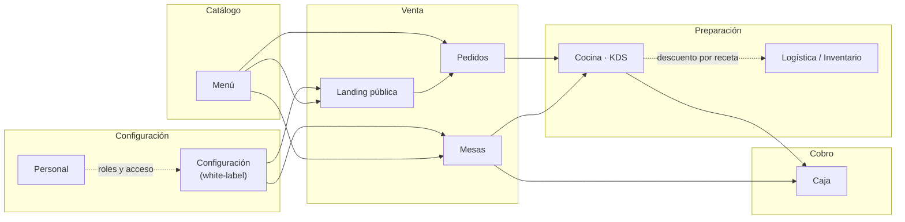
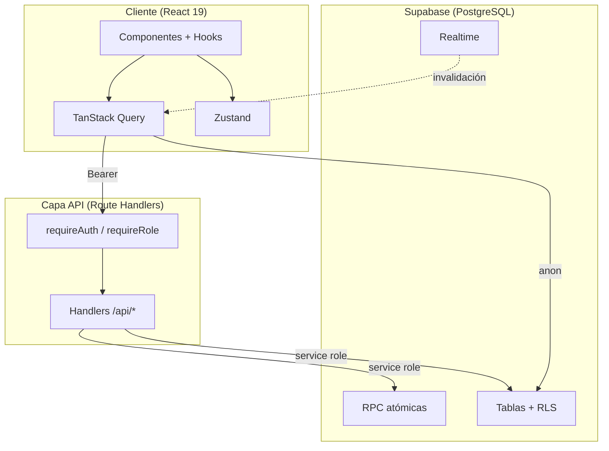

# Restaurant Management System (RMS)

> Sistema de gestión integral para restaurantes: **punto de venta, mapa de mesas, cocina en tiempo real (KDS), caja, menú, inventario con recetas, personal, configuración white-label y landing pública con pedidos en línea** — todo en una sola aplicación Next.js, con la identidad del negocio 100 % configurable desde el panel.

<p align="center">

[](https://nextjs.org/)
[](https://react.dev/)
[](https://www.typescriptlang.org/)
[](https://tailwindcss.com/)
[](https://supabase.com/)
[](https://vercel.com/)
[](#uso-y-licencia)

</p>

---

## Qué es

**RMS** es un sistema web de gestión para restaurantes y negocios de comida, pensado para operar el día a día completo del local: desde que un cliente pide desde el menú público hasta que se cobra la cuenta y se descuenta el inventario.

No es "solo un POS". El punto de venta es **uno de sus módulos**; el sistema cubre además el salón (mapa de mesas), la cocina (KDS en tiempo real), la caja, el catálogo, la logística/inventario, el personal y la configuración del negocio.

Su rasgo distintivo es el enfoque **white-label**: la identidad del negocio (nombre, colores, contacto, horarios, canales de venta, impuestos y operación) vive en **una sola fila de configuración** en la base de datos, no en el código. Cada negocio tiene su propio despliegue y su propia base de datos; el código es el mismo, pero no hay multi-tenant ni SaaS — es un producto por instancia.

---

## Demo en vivo

> **[rms.rvital.dev](https://rms.rvital.dev)**  
> Demo pública con datos ficticios y recorrido guiado. Credenciales de staff disponibles en la landing.

---

## Módulos

| Módulo | Qué hace |
| --- | --- |
| **Landing pública** | Menú en vivo desde la base de datos, configurador de producto (tamaños, salsas, picante, extras), carrito con delivery/pickup y pedido en línea. SEO y JSON-LD dinámicos por negocio. |
| **Dashboard** | KPIs en vivo: ventas del día, ocupación de mesas, pedidos activos, productos agotados; accesos rápidos y estado del salón. |
| **Mesas** | Mapa visual con estados (libre / ocupada / cobrando), apertura con comensales, unión y separación de mesas, redistribución y restitución de sillas, comandas a cocina e historial por mesa. |
| **Pedidos** | Kanban (Pendientes / En Cocina / Listo) más historial en tabla, con detalle, búsqueda, filtros y avance de estado validado servidor. |
| **Cocina (KDS)** | Kitchen Display System en tiempo real: cola de aceptación y pedidos en preparación, marcado de items listos, avance automático a "listo" y alerta sonora. |
| **Caja** | Cobro atómico por mesa o por orden individual, métodos de pago, desglose de impuestos y resumen del día por método. |
| **Menú** | CRUD de platillos con categorías, precios, tiempos, imágenes y opciones dinámicas (tamaños, salsas, niveles de picante, extras), con estado "agotado". |
| **Logística / Inventario** | Insumos con stock mínimo, libro de movimientos inmutable (entrada/salida/merma/conteo), recetas con descuento automático por venta y alertas de bajo stock. |
| **Personal** | Administración de usuarios del staff: roles, PIN de 6 dígitos, activar/desactivar, con protección anti-bloqueo. |
| **Configuración** | Panel white-label: identidad y colores de marca, carrusel del hero, contacto, horarios (con cruce de medianoche), canales de venta, impuestos y operación del POS. |



<sub>El **Dashboard** es una vista de solo lectura sobre Pedidos, Mesas y Productos.</sub>

---

## Stack tecnológico

| Capa | Tecnología | Por qué |
| --- | --- | --- |
| **Framework** | Next.js 16 (App Router, Turbopack) | Renderizado híbrido y Route Handlers como capa de API; el middleware se renombró a `proxy.ts`. |
| **Lenguaje** | TypeScript 5.7 en modo estricto | Tipos en todas las fronteras, sin `any`; tipos de base de datos derivados de una fuente única. |
| **UI** | Tailwind CSS v4 + shadcn/ui (Radix UI) | Tokens en CSS y componentes accesibles sin reinventar primitivas. |
| **Animación** | Framer Motion | Transiciones declarativas de modales y paneles. |
| **Datos en servidor** | TanStack Query | Caché, revalidación y deduplicación de peticiones con invalidación por Realtime. |
| **Estado local** | Zustand | Solo estado de sesión (`auth`) y carrito; el resto vive en el servidor. |
| **Validación** | Zod + React Hook Form | Contratos de validación en tiempo de ejecución y tipos inferidos (`z.infer`). |
| **Backend / BD** | Supabase (PostgreSQL, Auth, Realtime, Storage) | Base relacional con RLS, autenticación JWT, suscripciones en vivo y almacenamiento de assets. |
| **Rate limiting** | Upstash Redis | Límite por IP, por PIN y global para el login y las APIs. |
| **Deploy** | Vercel | Auto-deploy desde la rama principal. |

---

## Arquitectura

Arquitectura limpia por funcionalidades sobre Next.js App Router. El cliente es de **solo lectura** (SELECT + Realtime vía RLS); toda mutación pasa por Route Handlers con el service role de Supabase, y las operaciones críticas (cobro, transición de estado, inventario) son **RPC atómicas en PostgreSQL**.



→ [Arquitectura completa](docs/ARCHITECTURE.md) · [Capa DEMO](docs/DEMO-LAYER.md)

---

## Decisiones de ingeniería y trade-offs

- **Escrituras solo por API (service-role) en vez de RLS de escritura.** Centraliza la autorización en el servidor, permite auditar y validar cada mutación y elimina la posibilidad de saltarse los permisos desde el cliente. Costo: el cliente no puede escribir directo, pero la app es *read-heavy* y no lo necesita.
- **Operaciones atómicas en PostgreSQL (RPC) en lugar de lógica en la aplicación.** El dinero y los estados no se corrompen ante condiciones de carrera; un cobro o una transición es una sola transacción.
- **Supabase como BFF.** Auth, Postgres, Realtime y Storage en un solo proveedor, con tipos generados automáticamente y RLS para lecturas.
- **Zustand mínimo + TanStack Query.** El estado de servidor no se duplica en el cliente; solo sesión y carrito viven localmente. Las mutaciones esperan la confirmación del servidor (sin *optimistic updates*), priorizando la consistencia del dinero.
- **White-label por fila de configuración, mono-instancia.** Cada despliegue sirve a un negocio; esto evita la complejidad de un multi-tenant real y encaja con el objetivo. El aislamiento multi-negocio queda fuera de alcance a propósito.
- **Validación Zod en cada frontera.** Los datos que cruzan el sistema se validan en tiempo de ejecución y el tipo se infiere del esquema, evitando la desincronización entre validación y tipos.

---

## Calidad y pruebas

- **Suite de pruebas unitarias (Vitest)** sobre la lógica pura: 24 archivos con cientos de casos que cubren precios, transiciones de estado, algoritmos de distribución de sillas, inventario, validación de schemas, rate limiting del login y el motor del recorrido guiado de la demo.
- **Historial de auditorías (v1 → v9)** que cierra hallazgos de seguridad, integridad de datos, rendimiento y accesibilidad. La auditoría v9 reevaluó los cierres anteriores y endureció el modelo de acceso (escrituras solo-API, RPC transaccionales, login con PIN de 6 dígitos y contraseña derivada, precios 100 % server-side). Ver [`CHANGELOG.md`](./CHANGELOG.md).
- **Documentación viva de diseño** y changelog versionado.

---

## Autor

**Ricardo Vital Negrete** 

- GitHub: [@Ricardo-Vtl](https://github.com/Ricardo-Vtl)
- Portafolio: [rvital.dev](https://rvital.dev)
- LinkedIn: [linkedin.com/in/ricardo-vital-dev](https://www.linkedin.com/in/ricardo-vital-dev)

---

## Uso y licencia

Este repositorio se publica **únicamente como vitrina y material de evaluación** de mi trabajo. **Todos los derechos reservados.**

Puedes **ver** el código y **usar la demo pública** para conocer el proyecto. **No** se concede permiso para copiar, modificar, redistribuir, publicar ni explotar comercialmente este software, total o parcialmente, sin autorización previa y por escrito. Ver el archivo [`LICENSE`](./LICENSE) para el aviso completo.

---

## Correr localmente

<details>
<summary>Desplegar instrucciones para levantar el proyecto en local</summary>

**Requisitos:** Node.js ≥ 20, pnpm ≥ 9, un proyecto de Supabase y una base de datos Redis (Upstash).

```bash
# 1. Dependencias
pnpm install

# 2. Variables de entorno (crea .env.local)
#    NEXT_PUBLIC_SUPABASE_URL
#    NEXT_PUBLIC_SUPABASE_ANON_KEY
#    SUPABASE_SERVICE_ROLE_KEY
#    AUTH_PASSWORD_SECRET
#    UPSTASH_REDIS_REST_URL
#    UPSTASH_REDIS_REST_TOKEN

# 3. Esquema de base de datos (aplica las migraciones versionadas)
supabase link && supabase db push    # o `supabase db reset` en local

# 4. Desarrollo
pnpm dev          # http://localhost:3000

# 5. Pruebas
pnpm test
```

Los datos de demo se siembran con las migraciones `*_demo_seed*`, y el staff con `pnpm demo:bootstrap` (requiere `AUTH_PASSWORD_SECRET`).

</details>

---

<p align="center">
  <sub>Next.js · React · TypeScript · Supabase · Tailwind CSS · shadcn/ui</sub>
</p>
