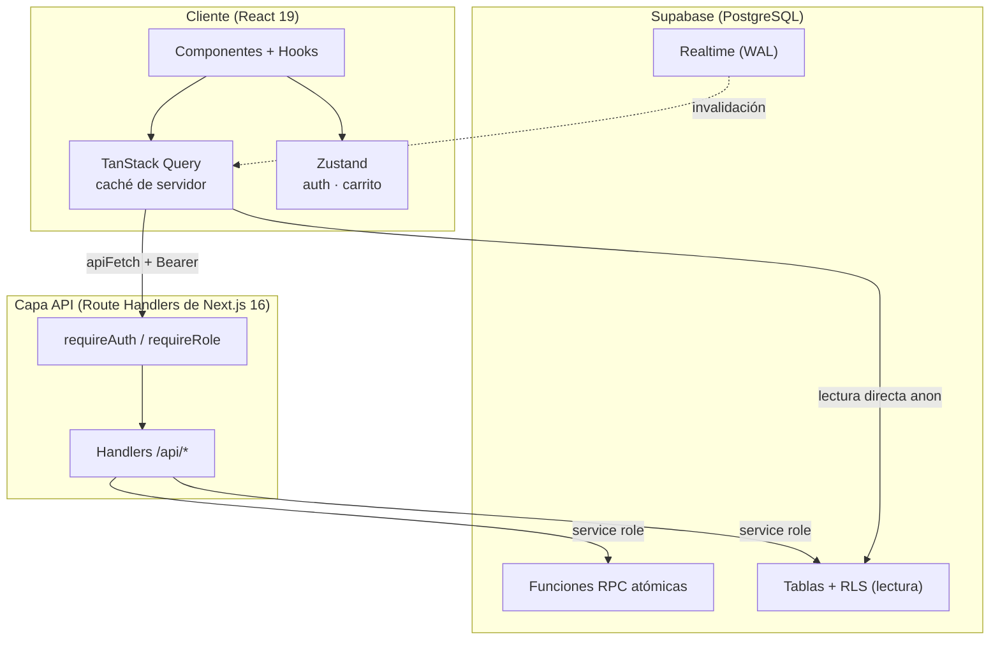
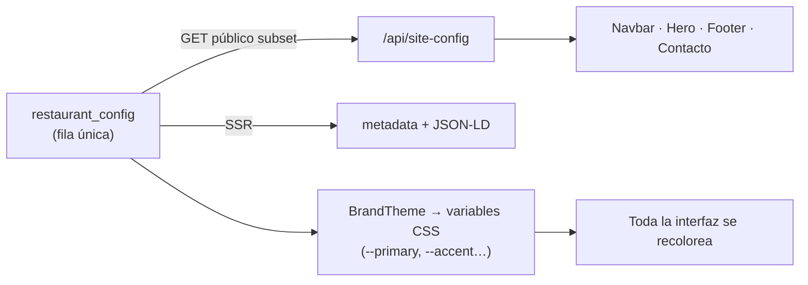
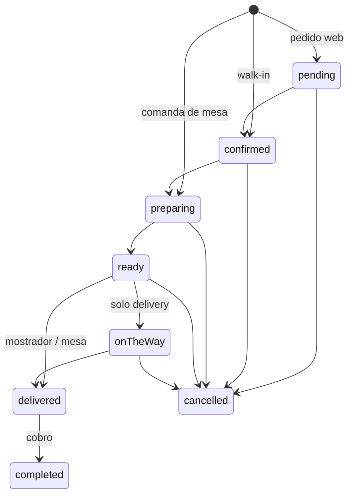

# Arquitectura — Restaurant Management System (RMS)

> Documento de profundidad técnica del sistema. El resumen vive en el
> [`README.md`](../README.md) raíz.

## Capas

El proyecto combina una **arquitectura limpia por funcionalidades (feature-based)** con el App Router de Next.js. Cada módulo del panel encapsula sus componentes, hooks y utilidades en subdirectorios `_components/`, `_hooks/` y `_utils/`.

- **Capa de persistencia:** Supabase PostgreSQL. Contiene el esquema relacional, las funciones RPC atómicas y las políticas RLS.
- **Capa de API:** Route Handlers en `app/api/*/route.ts`. Cada handler mutacional verifica el token JWT, la pertenencia al staff y el estado activo del usuario antes de escribir.
- **Capa de estado local:** Zustand guarda únicamente la sesión y el carrito.
- **Capa de estado de servidor:** TanStack Query encapsula las peticiones y la caché, con Realtime como disparador de invalidación.
- **Capa de presentación:** componentes React sin lógica de negocio directa; consumen hooks tipados.

## Seguridad y control de acceso

- **Escrituras solo por API.** `INSERT/UPDATE/DELETE` están **revocados** a los roles `anon`/`authenticated` en todas las tablas públicas: el cliente es de **solo lectura** (SELECT + Realtime vía RLS) y toda mutación pasa por el servidor con el rol de servicio. Esto elimina el bypass de permisos vía PostgREST.
- **Autenticación por PIN, no por contraseña.** `/api/auth/login` resuelve al empleado por RPC (`get_staff_by_pin`, con `pgcrypto`) y luego firma sesión con una **contraseña derivada** (`HMAC-SHA256` de `AUTH_PASSWORD_SECRET` + el `auth_id`). El PIN nunca es la contraseña de Supabase Auth y jamás llega al cliente.
- **Rate limiting en capas.** Límite por IP, por PIN y global sobre el login; respuesta 401 única ante cualquier fallo (sin oráculo de enumeración).
- **Permisos centralizados.** `lib/abilities.ts` es la **fuente única** rol→acción, consumida tanto por las rutas API como por la UI. Los cambios de estado por par `from→to` se gobiernan aparte en `lib/status-transitions.ts`.
- **Funciones endurecidas.** Las RPC son `SECURITY DEFINER` con `search_path` fijo y `EXECUTE` restringido al rol de servicio.
- **Headers estrictos.** CSP, HSTS, `X-Frame-Options`, `nosniff` y `Permissions-Policy` en `next.config.mjs`; cualquier origen externo nuevo debe añadirse a la CSP **y** a `images.remotePatterns`.

| Rol | Puede |
| --- | --- |
| **Administrador** | Todo el sistema. |
| **Mesero** | Crear pedidos, operar mesas y entregar. |
| **Cocina** | KDS (aceptar y marcar listo), inventario (movimientos y vista). |
| **Caja** | Cobrar, cancelar, reabrir, gestionar menú e inventario (movimientos). |

## Modelo de datos

- **9 tablas de negocio:** `products`, `staff_users`, `tables`, `orders`, `order_items`, `restaurant_config` + `supplies`, `supply_movements`, `recipes` (inventario).
- **7 tipos enumerados** (roles, estados de orden/mesa/pago, tipos de orden, método de pago, tipo de movimiento).
- **~15 funciones RPC** para todo lo que debe ser atómico: transición de estados, alta de items, cancelación, cobro, descuento de inventario y gestión de personal.
- **Borrado lógico** mediante `is_active` (productos, mesas, personal) para preservar el histórico.

Las operaciones de dinero y de estado viven en **transacciones de base de datos**, no en el código de la aplicación: por ejemplo, `transition_order` valida el estado esperado (actualización optimista), `complete_checkout` cobra una mesa completa o una orden, y las funciones de inventario mantienen el libro de movimientos consistente.

## Tiempo real

Una única suscripción a los cambios de `orders`, `order_items` y `tables`. Los eventos de pedidos se **coalescen en una sola invalidación** (debounce), de modo que un lote de comanda (1 orden + N items) provoca un solo refetch en lugar de N. Al insertarse una orden se emite un evento que dispara la alerta sonora del KDS. El canal se reconecta con backoff si se cae.

## White-label

La identidad del negocio se sirve en un **subconjunto público** desde `/api/site-config` y alimenta la landing, el tema (variables CSS) y el SEO. El panel completo de configuración (operación, impuestos, RFC) solo se expone por la ruta autenticada. En código **nunca** hay un nombre de negocio literal: se usan valores de respaldo y la configuración real.

## Ciclo de vida de un pedido

- **Tres orígenes:** el pedido **web** nace `pending` (por confirmar); el **walk-in** de caja nace `confirmed`; la **comanda de mesa** nace directo en `preparing` para aparecer de inmediato en cocina.
- **Cocina:** al marcar los items, la orden se promueve a `ready` automáticamente cuando **todos los items activos** están listos.
- **Cascada de items:** cada item tiene su propio estado; al cambiar el estado de la orden, los items avanzan **solo hacia adelante** y los cancelados nunca se reviven.
- **Cobro:** exige que no queden items en cocina; libera la mesa y congela el impuesto del momento para que un cambio de tasa no afecte órdenes pasadas.
- **Reapertura:** añadir items a una orden entregada la reabre explícitamente (no es una transición normal del estado).

### Descuento automático de inventario

Cada platillo puede tener una **receta** (producto + tamaño → insumo × cantidad). Cuando la orden entra a `preparing`, un trigger descuenta el stock de cada insumo según la receta, de forma **idempotente** (un item descuenta una sola vez, marcado con `depleted_at`). Si el item se cancela antes de cocinarse, el stock se repone con movimientos compensatorios; un plato ya preparado se considera merma y se corrige con un conteo físico. **El descuento nunca bloquea la venta** (un stock negativo es señal de conteo desactualizado); los movimientos manuales sí validan que el stock no quede negativo.
