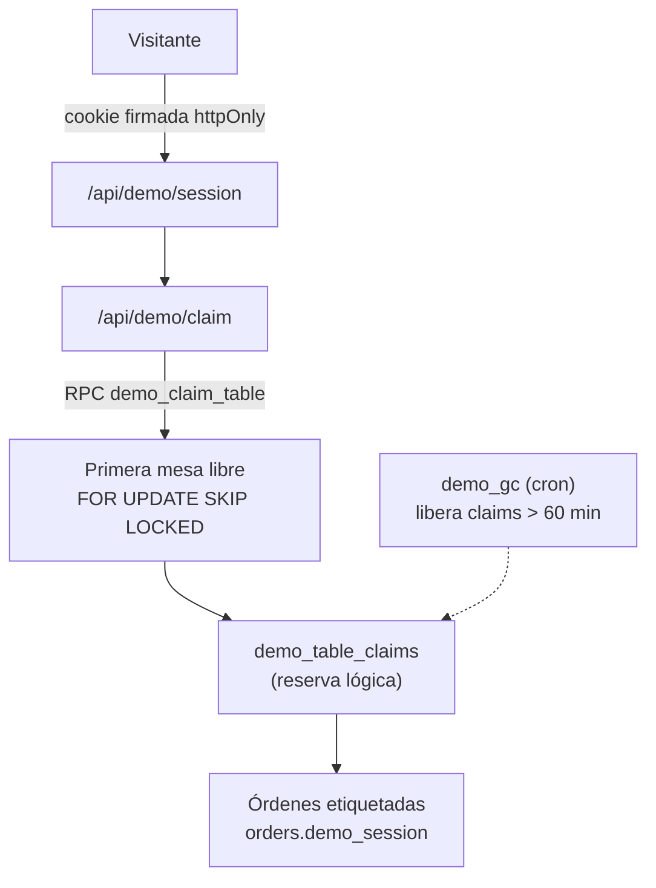

# Capa DEMO — Restaurant Management System (RMS)

> Este repositorio es la **demo pública** de RMS. Es el mismo producto que el
> proyecto base, **más una capa adicional** construida para exponerlo de forma
> segura a visitantes: el recorrido guiado y el aislamiento por sesión. Este
> documento describe **solo esa capa**. El resumen vive en el
> [`README.md`](../README.md) raíz.

## El modelo fork / sync

El producto oficial vive en un repositorio privado. Esta demo es un **fork** que
se sincroniza periódicamente con él mediante un script que aplica los cambios de
código del upstream por merge 3-way, **excluyendo** la documentación interna y
los archivos locales. La capa demo (tour, aislamiento, seed) es **aditiva**:
nunca se sube al proyecto padre.

## Aislamiento por sesión

El problema: la demo escribe sobre una base compartida y sin aislamiento una
visita podría pisar las mesas u órdenes de otra.

La solución combina cinco piezas:

1. **Cookie de sesión firmada** (`HMAC-SHA256`, `httpOnly`): el identificador nunca se expone al cliente, así que nadie puede forjar ni liberar la mesa de otra sesión.
2. **Claim atómico de mesa:** cada sesión reserva la primera mesa libre no reclamada (con `FOR UPDATE SKIP LOCKED`), sin bloquear a otros visitantes.
3. **Órdenes etiquetadas** con el identificador de sesión, para acotar todo al sandbox del visitante.
4. **Recolección de basura:** un cron libera claims abandonados (>60 min) y cancela órdenes activas huérfanas (>24 h); un *heartbeat* refresca la actividad en cada escritura.
5. **Realtime apagado** en modo demo, para evitar refrescos y sonidos cruzados entre visitantes.

## Recorrido guiado

Un motor propio de *tour* (25 pasos) que ilumina el elemento relevante de cada
pantalla y **avanza solo cuando el visitante hace la acción** (iniciar sesión,
crear un pedido, entregarlo, pagarlo). Los pasos informativos usan un botón
"Entendido"; los de acción no tienen botón y se completan al ejecutarse. El
diseño es *híbrido*: funciona igual en móvil y escritorio, abriendo los
contenedores ocultos (menú lateral, carrito, columnas) cuando el paso lo
requiere.

## Limitaciones conocidas

- El *claim* de mesa es **lógico** (no cambia el estado de la mesa) y tiene un TTL de 60 minutos; una sesión abandonada puede bloquear su mesa hasta que el GC la libere.
- Las **listas globales** (kanban, KDS, mapa y stock) siguen mostrando filas de otras sesiones; el aislamiento aplica a la mesa reclamada y al auto-marcado del tour, no a la lectura global.
- Los **PIN de la demo son públicos** a propósito (es una demo abierta); el acceso es al sandbox, no a datos reales.
